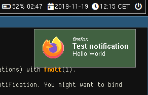

# Fnott

Fnott is a keyboard driven and lightweight notification daemon for
wlroots-based Wayland compositors.

It implements (parts of) the Desktop Notification Specification.

## Supported features

* Summary
* Body
* Actions (requires a dmenu-like utility to display and let user select action)
* Urgency
* Icons

## Planned features

* Timeout
* Markup (markup tags are already filtered out, but not applied)

## Usage

Copy the example `fnottrc` to `${HOME}/.config/fnottrc` and edit to
your liking.

Start the daemon by running `fnott`. Note that it does **not**
daemonize or background itself.

Test it with e.g. `notify-send "this is the summary" "this is the body"`.

Use `fnottctl dismiss` to dismiss the oldest notification, `fnottctl
dismiss all` to dismiss **all** notifications, or `fnottctl dismiss
<id>` to dismiss a specific notification (use `fnottctl list` to list
currently active notifications).

Note: you probably want to bind at least `fnottctl dismiss` to a
keyboard shortcut in your Wayland compositor configuration.
